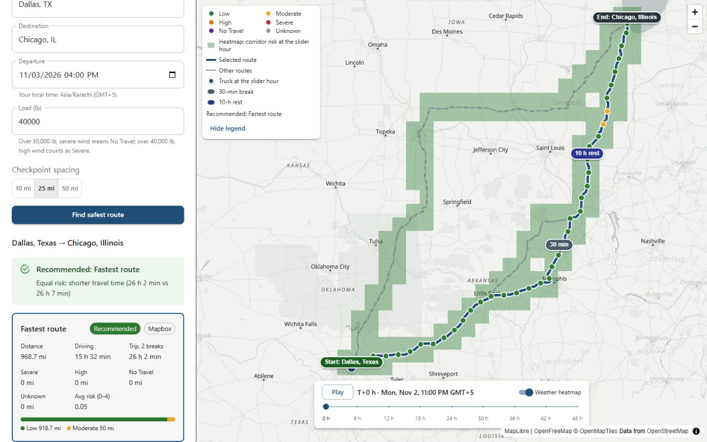
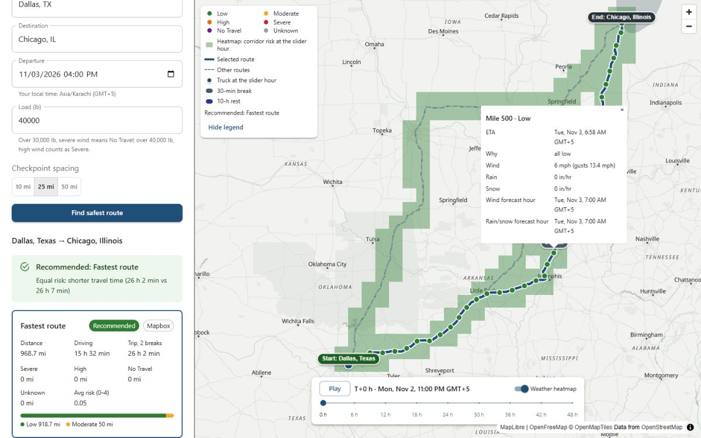
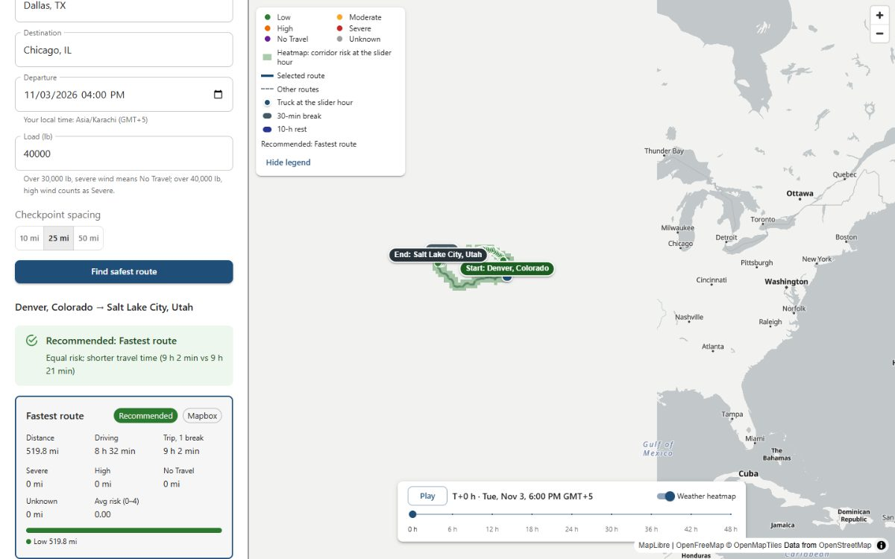
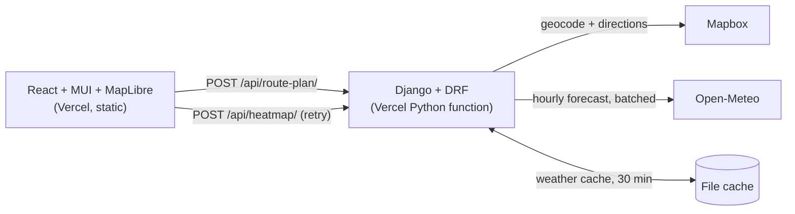

# spotter-routing

Weather-aware truck routing: compares up to 3 routes and recommends the safest, using the weather along each route,
the load weight and travel time. React + Django.

- **Live app:** https://spotter-routing-ameema.vercel.app
- **API:** https://spotter-routing-api.vercel.app (health check: `/api/health/`)
- **Loom walkthrough:** https://www.loom.com/share/dd06cacf76684728bac43abc59615a0a

## What it does

Enter an origin, a destination, a departure time and the load weight. The app finds 3 routes, works out when the truck
reaches each checkpoint (with legal driving breaks), fetches the forecast for that hour at each checkpoint, rates the
risk with the brief's wind, rain, snow and load rules, and recommends a route, with the reason. The map shows every
route, the coloured checkpoints, the stops, and a heatmap of the corridor that a 0–48 hour slider moves through time.

| Results and map | Checkpoint popup | Heatmap and slider |
|---|---|---|
|  |  |  |

## How to use

1. Type an origin and destination, or click a quick-fill chip (Dallas → Chicago, Denver → Salt Lake City,
   Kansas City → Denver).
2. Set the departure (local time, between 1 hour ago and 7 days ahead) and the load (up to 80,000 lb).
3. Pick the checkpoint spacing: 10, 25 (default) or 50 miles. Press **Find safest route**.
4. Read the banner (recommended route and why), compare the cards, and click a card or a route line to select it.
   Click a checkpoint for its ETA, level, the reason and the forecast hours used.
5. Drag the slider or press **Play** to move the heatmap and the trucks through the next 48 hours. Add `?perf=1` to
   the URL to see how long each slider update takes.

## How it works: the logic

| Part | What the app does | Decision |
|---|---|---|
| Routes | Mapbox Directions returns at most 2 routes and has no truck profile, so a third is generated: `exclude=toll` plus up to 4 interstate hub vias, sent in parallel. A candidate is accepted at ≤1.25× the fastest time and ≤75% overlap; the lowest overlap wins, otherwise "Only N distinct routes found". | D1, D7 |
| Truck ETA | 65 mph cap (an assumption), a 30-min break after 8 h of driving and a 10-h rest after 11 h, per the [FMCSA summary](https://www.fmcsa.dot.gov/regulations/hours-service/summary-hours-service-regulations) and [49 CFR 395.3](https://www.govinfo.gov/content/pkg/CFR-2023-title49-vol5/xml/CFR-2023-title49-vol5-sec395-3.xml). Dallas → Chicago goes from 15 h of driving to a 26 h trip, which changes the forecast hour at most checkpoints. | D8 |
| Sampling | A checkpoint every 10, 25 or 50 miles, each at its own ETA. Each checkpoint stands for the miles halfway to its neighbours ("half-gap" weights), so "Severe miles" are real miles. | D5 |
| Weather | Open-Meteo hourly forecast: rain = `rain + showers`, snow = `snowfall`, wind = sustained `wind_speed_10m` (gusts shown, not rated). Precipitation uses the hour ending at or after the ETA; wind uses the nearest hour. | D2 |
| Risk bands | The brief's table, with lower-inclusive edges (25 mph is Moderate); Severe keeps its top value for rain and snow (1.00 in/hr is Severe, above is No Travel); wind ≥55 mph is No Travel. | D3 |
| Combining + load | The worst of wind, rain and snow, then the load rules, which can only raise a level: ≥55 mph No Travel for any load; 45–54 mph over 30,000 lb No Travel; 35–44 mph over 40,000 lb Severe. A missing input gives Unknown, unless No Travel is already proven. | D4 |
| Ranking | Tiers first: clean routes, then over 25% unknown miles, then any No Travel miles. Inside a tier, the brief's order: fewest Severe miles, fewest High miles, lowest average risk (distance-weighted), shortest trip time. Only a clean route is recommended, otherwise none ("No safe route — consider delaying departure"). The reason names the deciding criterion. | D5 |
| Heatmap | Up to 250 points on a fixed grid around the routes, each with 49 hourly levels (hour 0 = departure) from the same rules as the checkpoints. The slider only changes which hour the colour reads; the data is built once per search. | D9, D12 |

## Architecture



- **One endpoint** answers a search: routes, checkpoints, stops, summaries, ranking, the recommendation and reason, and
  the 48-hour heatmap, in about 11 KB gzipped. The contract is the `build_route_plan` docstring in
  `backend/routing/services/route_plan.py`. The pure logic lives in `backend/routing/domain/` with no Django imports.
- **Heatmap retry:** if Open-Meteo is busy, the routes still arrive and the heatmap grid comes without levels.
  The app retries once after 60 s (or on **Retry now**) with `POST /api/heatmap/`, which reuses cached cells and calls
  no routing API. The map view, slider hour and selected route stay as they were (D14).
- **Caching:** forecasts are cached per point for 30 minutes, snapped to 0.02° (0.1° changed storm-rain levels for
  almost no savings) (D6). No geocode or route caching.
- **Throttling:** per client, 10 searches a minute and 100 a day; heatmap retries have their own 10/min and 100/day.
- **Errors:** every failure is `{error}`: 400 field errors, 422 place or route not found (with the field), 429 too many
  requests, 502 provider error, 503 weather busy, 504 provider timeout.

## Performance and quality

| Measure | Result |
|---|---|
| Slider update (live site, `?perf=1`, Intel Iris Xe laptop GPU) | About 2.6 ms of React work; drawn in the next frame (15.6 ms median, p95 30 ms) |
| Lighthouse (live site, desktop) | Performance 89, Accessibility 100, Best practices 100 |
| Search time (live) | Fresh 3.3 s, repeat 2.1 s, cold start 7.7 s; QA searches 2.0–4.7 s |
| Response size | About 11 KB gzipped |
| Tests | Backend 465 (pytest), frontend 89 (Vitest); core logic written test-first |
| Deliberate bugs | 35 injected into the logic (15 in geo/weather-time/risk, 20 in ranking), all caught; one gap found and closed |
| Heatmap vs checkpoints | Agree 95.9% (117/122); the rest differ by one level |
| QA | Requirements checklist, 4 live searches and a 28-row UI matrix (rare outcomes, errors, form, keyboard, phone): [docs/QA.md](docs/QA.md) |

## Key decisions

Full list, with the minor defaults: [DECISIONS.md](DECISIONS.md).

| # | Decision | Why |
|---|---|---|
| D1 | Mapbox Directions + Geocoding | Checked with real calls; it returns at most 2 routes, so a third is generated |
| D2 | Open-Meteo, rain = rain + showers, wind = sustained | Free hourly forecast in mph and in/hr, batched per call |
| D3 | Lower-inclusive band edges | The table's shared edges need one rule, tested at every edge |
| D4 | Worst of wind/rain/snow; load rules only raise | Safety first; missing data is Unknown, never Low |
| D5 | Half-gap mile weights; tiers, then the brief's order; recommend only a clean route | "Severe miles" are real miles; an unsafe route is never recommended |
| D6 | Cache weather 30 min at 0.02° | Fewer calls without changing storm-rain levels |
| D7 | Third route from avoid-tolls + hub vias | Distinct, realistic routes instead of random offsets |
| D8 | 65 mph cap + hours-of-service breaks | ETAs, and so forecast hours, match a legal truck trip |
| D9 | Heatmap of ≤250 cells, 49 hours, in the same response | One call; the per-minute weather budget allows it |
| D10 | Backend on Vercel Hobby (Render as fallback) | No fixed sleep and a 300 s limit, free |
| D11 | MapLibre + OpenFreeMap basemap | GPU layers and no key in the browser |
| D12 | Heatmap as grid squares; the slider only changes the colour rule | Smooth slider: no data rebuilt per hour |
| D13 | Plain TypeScript + Vitest for pure helpers | Typed API, tested logic, no extra tooling |
| D14 | Heatmap retry endpoint, auto retry after 60 s | A busy weather service costs a minute, not a whole new search |
| D15 | No cut in weather locations (263 per search) | A 14% saving would make the heatmap blockier |

## Limitations and next steps

- **Car-profile routing:** Mapbox has no truck profile (height, weight or hazmat limits). Next: a truck routing API.
- **Hours of service simplified:** the 60/70-hour limits, sleeper-berth split, adverse-conditions extension, team
  driving, on-duty non-driving time and real rest-stop locations are not modelled.
- **Weather provider limits:** Open-Meteo's free tier counts each location (600/min, 5,000/hour, 10,000/day), and
  Vercel's outbound IPs are shared, so a busy moment can hit the limit. The heatmap retry covers the common case;
  a paid plan or a fixed-IP host is next.
- **Per-instance cache and throttling:** both live on one serverless instance and reset on redeploy. Next: Redis.
- **Fuzzy geocoding:** a misspelling is matched silently (the matched place is shown, with no "did you mean").
- **Phone slider:** the hour labels are hidden and the time label wraps.
- **Free-tier hosting:** a cold start took 7.7 s after 20 idle minutes; the app shows "Starting the server…" while it
  wakes.

## Run locally

**Backend** (Python 3.11 or 3.12), from the repo root (PowerShell):

```powershell
python -m venv .venv
.\.venv\Scripts\Activate.ps1
pip install -r backend/requirements.txt
Copy-Item backend\.env.example backend\.env   # then set DEBUG=True and MAPBOX_TOKEN
cd backend
pytest
python manage.py runserver
```

`SECRET_KEY` can stay blank locally. Check http://127.0.0.1:8000/api/health/, which returns `{"status":"ok"}`.

**Frontend** (Node 20.19+ or 22.12+):

```powershell
cd frontend
npm install
Copy-Item .env.example .env   # VITE_API_URL: the live API, or http://127.0.0.1:8000
npm run dev                   # http://localhost:5173; also npm run test, lint, build
```

The basemap is OpenFreeMap's Positron style and needs no key.

## Deploy

Two Vercel projects from this repo.

- **Backend:** Root Directory `backend` (Python 3.12, pinned in `backend/.python-version`; Vercel detects Django and
  runs `collectstatic`). Environment: `SECRET_KEY` (new random key), `DEBUG=False`, `ALLOWED_HOSTS` (domain, no
  `https://`), `CSRF_TRUSTED_ORIGINS` (URL with `https://`), `CORS_ALLOWED_ORIGINS` (frontend origins, comma-separated),
  `MAPBOX_TOKEN`, `CACHE_DIR=/tmp/spotter-cache` (the rest of the filesystem is read-only).
- **Frontend:** Root Directory `frontend`, Vite preset. Set `VITE_API_URL=https://spotter-routing-api.vercel.app`
  (read at build time, so redeploy after changing it), and list the frontend origin in the backend's
  `CORS_ALLOWED_ORIGINS`.
- **Fallback:** `render.yaml` deploys the backend to Render's free tier with gunicorn (sleeps after 15 idle minutes,
  about a minute to wake; leave `CACHE_DIR` unset).

## AI assistance

I planned the work with Claude (chat) and built it with Claude Code, one block at a time. I made every decision
(DECISIONS.md), reviewed each plan and the tests before code went in, and checked the results in the browser.
Time spent: about 14.75 hours of the 16-hour limit (log in [PROGRESS.md](PROGRESS.md)).
